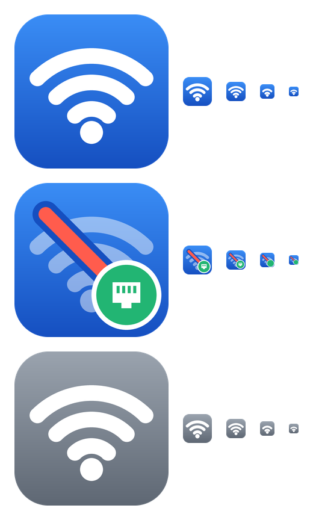

# wlanmute

A small, native C++/Win32 Windows 11 tray utility for USB-monitor/dock Ethernet users.
It prefers **Internet-capable Ethernet** over **Wi-Fi on the same subnet**.
When that Ethernet connection is unplugged or Windows reports that it has lost
Internet access, wlanmute reconnects the saved Wi-Fi profile it disconnected.



The tray icon shows the current state:

| Icon | Meaning |
| --- | --- |
| Blue Wi-Fi | Monitoring; Wi-Fi is not being suppressed |
| Slashed Wi-Fi + green Ethernet badge | Ethernet preferred; Wi-Fi disconnected by wlanmute (also the EXE icon) |
| Gray Wi-Fi | Automatic switching paused, or a network error occurred (see **Recent activity**) |

## Download and run

Download a single EXE from [Releases](https://github.com/nanosonde/wlanmute/releases):

- `wlanmute-win-x64.exe` for Intel/AMD PCs.
- `wlanmute-win-arm64.exe` for Windows on ARM.

Run it as your normal user. No installer, .NET installation, or routine
administrator elevation is needed. Look in the system tray, including hidden
icons. Right-click for **Automatic switching**, **Check now**, **Recent activity**,
and **Exit (restore Wi-Fi)**. Recent activity opens a live table of the latest
30 events. Turning automatic switching off restores any Wi-Fi
connection owned by the app. Exiting waits for restoration to be confirmed;
if it fails, the app stays paused and reports the problem rather than silently
leaving Wi-Fi disconnected.

The C++ runtime is statically linked. There are no bundled runtime DLLs, startup
extraction, or supporting files: **one EXE is the entire application**. It uses
only Windows' built-in system DLLs. Releases are unsigned, so Windows SmartScreen
may warn about an unfamiliar publisher. It does not add itself to Windows startup;
if desired, place a shortcut in your user Startup folder (`shell:startup`).

## Behavior and safeguards

- Checks every three seconds; Windows connectivity detection and Wi-Fi
  association can add delay. Reconnection requests retry after 30 seconds if
  Wi-Fi is still disconnected; ongoing association is not interrupted.
- Uses Windows Network List Manager's **per-adapter** IPv4/IPv6 Internet status.
  An Ethernet link being plugged in, having an IP, or having a gateway alone is
  not sufficient. No custom web requests or external test servers are used.
- Compares IPv4/IPv6 network prefixes and prefix lengths. At least one exact
  subnet must match. Ignores link-local IPv6, APIPA, loopback, unspecified,
  multicast, and default-route prefixes. Overlapping but differently sized
  prefixes are deliberately not treated as the same subnet.
- Remembers the Wi-Fi subnet before disconnecting, so the lack of a Wi-Fi IP
  address afterward does not trigger immediate reconnection.
- Disconnects Wi-Fi via the native WLAN API, **never disables the adapter**,
  changes route metrics, disconnects Ethernet, or edits saved Wi-Fi profiles.
  Unrelated subnets and Wi-Fi that was already disconnected are left alone.
- Reuses Windows' saved profile; never reads or stores passwords. Temporary and
  ad-hoc connections are not managed. A manual connection to a
  different Wi-Fi profile cancels that interface's pending restoration.
- Supports multiple interfaces. Connected Ethernet-type virtual adapters can
  qualify too; VPN/tunnel adapter types are not treated as Ethernet. Identical
  subnet numbers are an address-based heuristic, not proof of the same physical
  network (for example, two separate networks can both use `192.168.1.0/24`).
- Switching state and recent activity are in memory only. After forced
  termination, a crash, or shutdown, you may need to reconnect Wi-Fi manually.
  Keep the app running to handle dock changes and sleep/resume.

Windows' Internet indication is the source of truth, not an independent
adapter-bound Internet probe. NCSI restrictions, VPNs, captive portals, and
Windows detection delays can affect it. Subnet comparison does not require the
Wi-Fi connection itself to have Internet access. Ethernet is always preferred,
not whichever connection appeared most recently.

On recent Windows 11 versions, querying the current Wi-Fi connection can require
**Settings > Privacy & security > Location** access. Denials and WLAN service
errors are reported rather than ignored; check **Recent activity**. WLAN AutoConfig
must be running. Wi-Fi must be enabled and the saved network in range to reconnect.

## Build and test

Requires CMake 3.20+ and Visual Studio 2022 (or newer) Build Tools with
**Desktop development with C++**, a Windows SDK, and the ARM64 C++ toolchain
for ARM64 builds.

```powershell
cmake -S . -B build/x64 -A x64
cmake --build build/x64 --config Release
ctest --test-dir build/x64 -C Release --output-on-failure
cmake -S . -B build/arm64 -A ARM64 -DBUILD_TESTING=OFF
cmake --build build/arm64 --config Release
```

Distribute only `build/x64/Release/wlanmute.exe` or
`build/arm64/Release/wlanmute.exe`; PDBs and build intermediates are not needed.
Policy tests also run on Linux without Windows dependencies:

```sh
cmake -S . -B build -DCMAKE_BUILD_TYPE=Release
cmake --build build --parallel
ctest --test-dir build --output-on-failure
```

The Windows app can be cross-compiled, but real docking,
WLAN permissions, and tray behavior must be tested on Windows hardware.
`wlanmute.exe --smoke-test` checks read-only NLM/WLAN API access without changing
any connections (requires WLAN AutoConfig).

### Icons

The icons in `src/icons/` (and the preview `docs/icons.png`) are generated from
code so the small tray sizes stay crisp. To change them, edit and run:

```sh
pip install pillow
python tools/make_icons.py
```

### GitHub Actions and releases

[Build and release](.github/workflows/build.yml) tests changes, publishes both
architectures, checks the single-file output, smoke-tests the x64 Windows APIs,
checks that there is no separate C++ runtime DLL dependency, and uploads EXEs as
workflow artifacts. A `vMAJOR.MINOR.PATCH` tag also publishes a GitHub release
with both EXEs, `SHA256SUMS.txt`, `LICENSE.txt`, and that version's [CHANGELOG.md](CHANGELOG.md)
section as release notes. The release fails if the tag does not match the
`VERSION` in `CMakeLists.txt` or the changelog has no entry for it.

No personal access token or secret needs to be added: the release job uses
GitHub's built-in token with narrowly scoped `contents: write` permission.

## Versioning, commits, and releases

- Versions follow [Semantic Versioning](https://semver.org): `fix` → patch,
  `feat` → minor, breaking change (`feat!:` or `BREAKING CHANGE:` footer) → major.
  While the version is `0.x`, breaking changes bump the minor version.
- Commit messages follow [Conventional Commits](https://www.conventionalcommits.org):
  `type(optional scope): description`, with types `feat`, `fix`, `perf`,
  `refactor`, `docs`, `build`, `ci`, `test`, `style`, and `chore`.
- [CHANGELOG.md](CHANGELOG.md) is generated from commits with
  [git-cliff](https://git-cliff.org) using [cliff.toml](cliff.toml).
  `test`, `style`, `chore`, and non-conventional commits are omitted.

To release (example: 0.3.0):

```sh
pip install git-cliff
# 1. Set `project(wlanmute VERSION 0.3.0 ...)` in CMakeLists.txt
git cliff --tag v0.3.0 -o CHANGELOG.md   # 2. regenerate the changelog
git commit -am "chore(release): 0.3.0"   # 3. release commit
git tag -a v0.3.0 -m "v0.3.0"            # 4. annotated SemVer tag
git push origin main v0.3.0              # 5. CI builds and publishes
```

## Hardware acceptance checklist

1. Connect Wi-Fi and USB Ethernet to the same LAN; wait for Windows to show
   Internet on Ethernet. Confirm Wi-Fi disconnects and Ethernet remains online.
2. Unplug the dock; confirm the original Wi-Fi profile reconnects.
3. Reattach it, then remove Ethernet's Internet access without unplugging;
   after Windows updates connectivity, confirm Wi-Fi restoration.
4. Try Ethernet without Internet and Wi-Fi on a different subnet; neither should
   cause Wi-Fi disconnection.
5. Pause and exit while Wi-Fi is muted; confirm restoration. Also test
   sleep/resume, denied location permission, and unavailable Wi-Fi.

## License

[MIT](LICENSE). The software is provided "as is", without warranty of any kind,
and the authors are not liable for any damages arising from its use.
